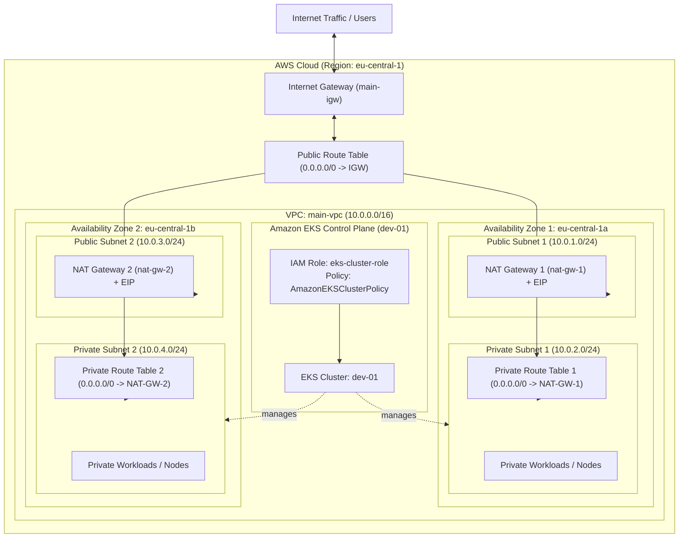

# EKS Cluster Infrastructure

Terraform codebase for provisioning a high-availability Amazon EKS (Elastic Kubernetes Service) cluster on AWS across multiple Availability Zones, including dedicated VPC networking and routing.

---

## Infrastructure Architecture Diagram

The diagram below illustrates the current infrastructure architecture defined across the VPC and EKS modules:



---

## Architecture Overview

### 1. Networking (`modules/vpc`)
- **VPC**: `10.0.0.0/16` with DNS support and DNS hostnames enabled.
- **Multi-AZ Deployment**: Deployed across 2 Availability Zones (`eu-central-1a` and `eu-central-1b`) for high availability and Kubernetes fault tolerance.
- **Public Subnets**:
  - `public-subnet-1` (`10.0.1.0/24`) in `eu-central-1a`
  - `public-subnet-2` (`10.0.3.0/24`) in `eu-central-1b` (tagged with `kubernetes.io/role/elb = 1`)
  - Auto-assign public IP enabled for ingress resources.
- **Private Subnets**:
  - `private-subnet-1` (`10.0.2.0/24`) in `eu-central-1a`
  - `private-subnet-2` (`10.0.4.0/24`) in `eu-central-1b` (tagged with `kubernetes.io/role/internal-elb = 1`)
- **Routing & Gateways**:
  - **Internet Gateway (`main-igw`)**: Connects public subnets to the internet.
  - **NAT Gateways (`nat-gw-1`, `nat-gw-2`)**: One dedicated NAT Gateway per AZ with an Elastic IP to allow private subnets outbound egress while maintaining high availability.
  - **Route Tables**:
    - 1 shared Public Route Table routing `0.0.0.0/0` to the Internet Gateway.
    - 2 independent Private Route Tables routing `0.0.0.0/0` to each respective AZ's NAT Gateway.

### 2. Kubernetes Cluster (`modules/eks`)
- **EKS Cluster**: Cluster named `dev-01`.
- **IAM Role**: `eks-cluster-role` with `sts:AssumeRole` trusted for `eks.amazonaws.com` and managed policy attachment `AmazonEKSClusterPolicy`.
- **Subnet Association**: Connected across subnets to support high-availability master and worker node communication.

---

## Repository Structure

```text
.
├── main.tf                 # Root module invoking child modules
├── variables.tf            # Input variable declarations
├── outputs.tf              # Root outputs (VPC ID, Subnet IDs)
├── provider.tf             # AWS Provider configuration
├── dev_values.tfvars       # Environment variables for dev
└── modules/
    ├── vpc/                # VPC, subnets, NAT Gateways, routing
    │   ├── main.tf
    │   ├── variables.tf
    │   └── outputs.tf
    └── eks/                # EKS cluster and IAM role definitions
        ├── main.tf
        └── variables.tf
```

---

## Deployment Instructions

### Prerequisites
- [Terraform](https://www.terraform.io/) >= 1.0
- [AWS CLI](https://aws.amazon.com/cli/) configured with appropriate AWS credentials

### Steps
1. **Initialize Terraform**:
   ```bash
   terraform init
   ```

2. **Validate & Plan**:
   ```bash
   terraform plan -var-file="dev_values.tfvars"
   ```

3. **Apply Configuration**:
   ```bash
   terraform apply -var-file="dev_values.tfvars"
   ```
